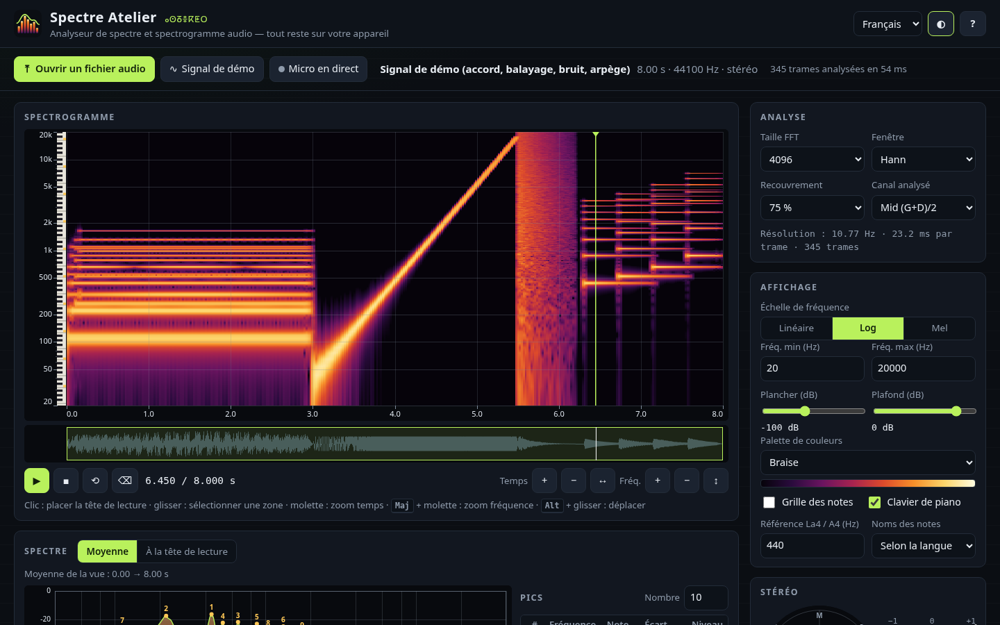
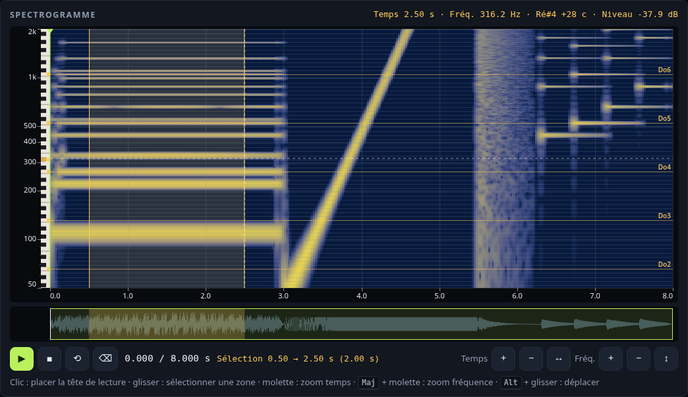
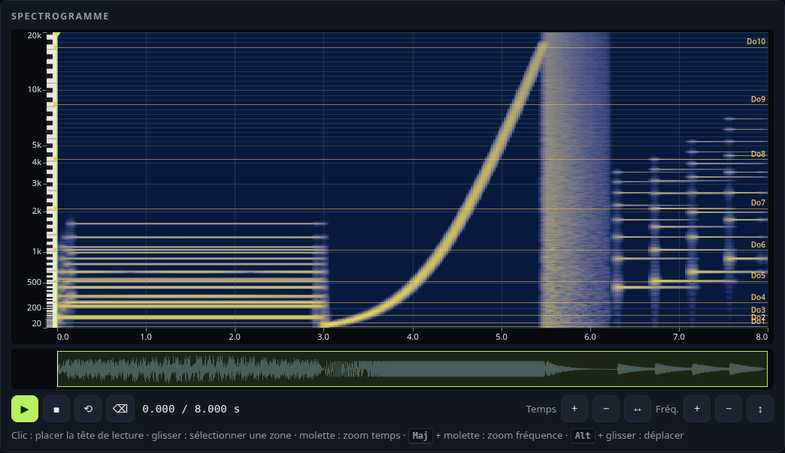
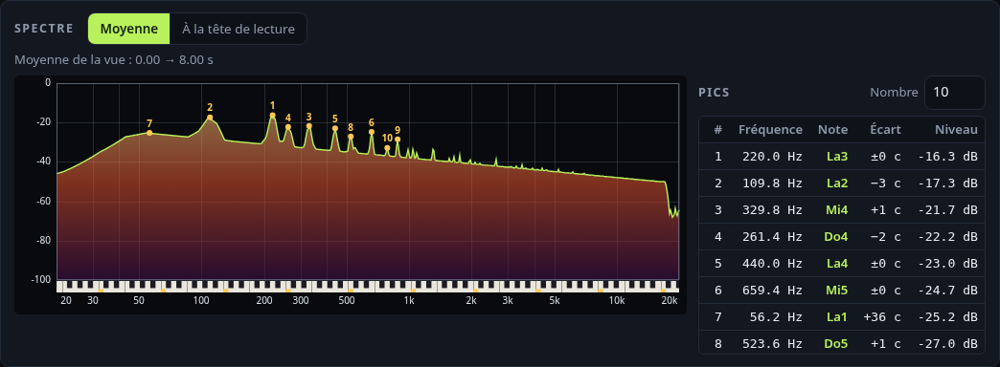
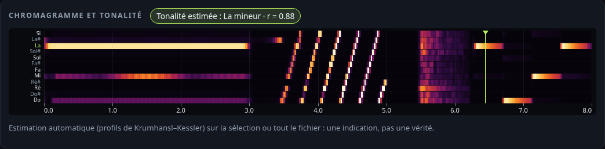
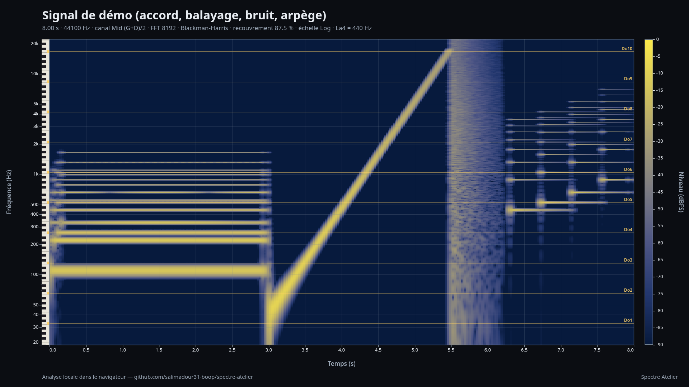
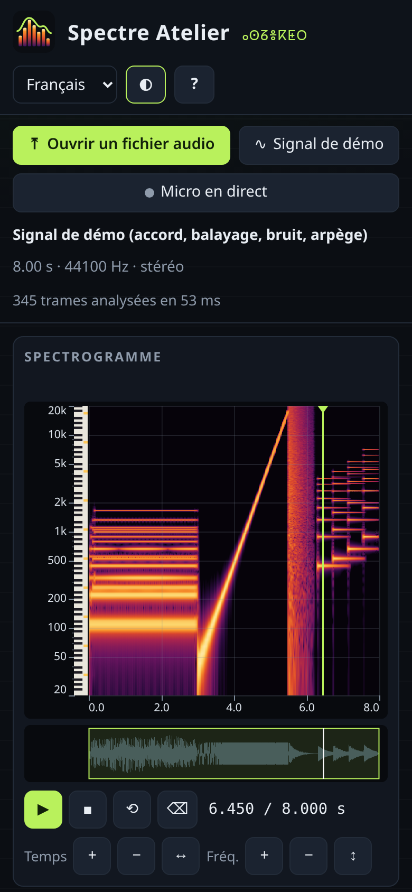

# Spectre Atelier 

**Analyseur gratuit de spectre et de spectrogramme audio**, dans le navigateur, pour musiciens, ingénieurs du son et sound designers : spectrogramme complet du fichier calculé par une **STFT maison** (FFT 512 à 16 384 points, fenêtres Hann / Hamming / Blackman-Harris, recouvrement réglable), axes **linéaire, logarithmique ou mel**, **lecture de la note la plus proche** (± cents) au survol, **spectre et pics** avec noms de notes, **chromagramme et tonalité estimée**, **vectorscope stéréo** et corrélation de phase, **lecture en boucle** d’une sélection, **micro en direct**, exports **PNG annoté haute résolution, CSV et JSON**.

👉 **Démo : https://salimadour31-boop.github.io/spectre-atelier/**

Interface en **français**, **anglais** et **taqbaylit** (avec affichage optionnel en **tifinagh** ⵜⵉⴼⵉⵏⴰⵖ). Aucun compte, aucune clé d’API, aucun traceur, aucune bibliothèque externe : tout est calculé localement et l’outil fonctionne hors ligne une fois chargé.



## Fonctionnalités

### Sources
- **Fichier audio local** : bouton ou **glisser-déposer** n’importe où sur la page (WAV, MP3, OGG, FLAC, M4A/AAC, Opus… selon ce que décode le navigateur via Web Audio).
- **Signal de démo synthétisé dans le code** (8 s stéréo) : accord de la mineur avec basse, balayage sinusoïdal exponentiel 40 Hz → 18 kHz, bouffée de bruit stéréo décorrélé, arpège pincé en ping-pong — l’outil fonctionne sans aucun fichier (chargé au démarrage).
- **Micro en direct** (facultatif) : spectrogramme défilant des 10 dernières secondes, spectre, pics, chromagramme et tonalité en temps réel (traitement d’écho, réduction de bruit et gain automatique désactivés pour une mesure fidèle).

### Spectrogramme
- **STFT écrite pour l’outil** (FFT radix-2) : tailles **512, 1024, 2048, 4096, 8192, 16 384**, fenêtres **Hann, Hamming, Blackman-Harris (4 termes), rectangulaire**, recouvrement **0 / 50 / 75 / 87,5 %**, niveaux en **dBFS** (un sinus pleine échelle = 0 dB). Résolution affichée (Hz par case, ms par trame).
- Calcul **par tranches** avec barre de progression : la page reste réactive même avec un long fichier.
- Échelles de fréquence **linéaire / log / mel**, fréquences min / max, **plancher et plafond en dB**.
- **7 palettes originales** : Braise, **Oasis (adaptée au daltonisme**, luminance strictement croissante bleu → jaune), Glacier, Sahara, Prisme, Gris, Encre (pour l’impression).
- **Zoom et défilement** en temps et en fréquence : molette (temps), `Maj` + molette (fréquence), `Alt` + glisser (déplacer), boutons, clavier, et **bande de vue d’ensemble** (forme d’onde) à faire glisser. Quand on dézoome, chaque pixel prend le **maximum** des cases qu’il couvre : aucun pic n’est perdu.
- **Lecture au survol** : temps, fréquence, **note la plus proche + écart en cents**, niveau.
- **Grille des notes** (lignes de Do étiquetées, demi-tons quand la place le permet) et **clavier de piano** le long de l’axe des fréquences ; **La4 de référence réglable** (400–480 Hz) ; noms **C D E** ou **Do Ré Mi** (automatique selon la langue).

### Spectre, lecture, extras
- **Spectre moyen** (puissance moyennée sur la vue ou la sélection) ou **trame sous la tête de lecture** (mise à jour pendant la lecture), avec **détection de pics** (interpolation parabolique) : tableau des N pics les plus forts avec fréquence, note, cents et niveau ; clavier de piano sous l’axe.
- **Lecture** avec tête de lecture synchronisée, clic pour se placer, **sélection d’une zone** par glisser et **lecture en boucle** de la sélection.
- **Stéréo** : analyse du canal **Mid (G+D)/2, Gauche, Droite ou Side (G−D)/2**.
- **Chromagramme** (énergie des 12 classes de hauteur au fil du temps) et **estimation de tonalité** (profils de Krumhansl–Kessler) sur tout le fichier ou sur la sélection.
- **Vectorscope stéréo** (Mid vers le haut, Side en largeur) autour de la tête de lecture, **corrélation de phase** locale et du fichier, **largeur S/M**.

### Exports et partage
- **PNG du spectrogramme** en **1920 × 1080, 3000 × 1500 ou 4096 × 2048**, avec titre, réglages, axes gradués, grille des notes / clavier si actifs, barre de couleurs en dBFS et sélection.
- **CSV des pics** (rang, fréquence, note, cents, niveau) et **CSV du spectre complet** (UTF-8, compatible tableur).
- **JSON** des réglages (+ source, vue, tonalité, pics) — réouvrable dans l’outil ; **lien partageable** : les réglages et la langue sont dans l’adresse (`#fft=8192&sc=mel&cm=oasis…`).
- Thème clair / sombre, responsive (bureau et mobile ~390 px), libellés accessibles, raccourcis clavier.

## Utilisation
1. Ouvrez la [démo](https://salimadour31-boop.github.io/spectre-atelier/) (ou `index.html` en local : aucun serveur ni installation nécessaires).
2. Le **signal de démo** est déjà analysé : survolez le spectrogramme, cliquez pour placer la tête de lecture, `Espace` pour écouter.
3. **Ouvrez votre fichier** (ou déposez-le), choisissez la **taille FFT** (grande = meilleure précision en fréquence, petite = meilleure précision en temps), l’échelle et la palette.
4. **Glissez** pour sélectionner un passage : le spectre moyen, les pics et la tonalité portent alors sur la sélection ; activez **⟲** pour l’écouter en boucle.
5. **Exportez** l’image ou les données, ou **copiez le lien** pour partager vos réglages.

Raccourcis (spectrogramme sélectionné) : `Espace` lecture / pause, `←` `→` déplacer la tête (`Maj` = ×10), `+` `−` `0` zoom temps, `Page préc.` / `Page suiv.` zoom fréquence, `L` boucle, `Échap` effacer la sélection.

## Captures
| Zoom 50 Hz–2 kHz, sélection, clavier de piano | Mel + palette Oasis (daltonisme) + grille des notes |
|---|---|
|  |  |
| **Spectre et pics avec noms de notes** | **Chromagramme et tonalité estimée** |
|  |  |

| Export PNG annoté (1920 × 1080) | Mobile (390 px) |
|---|---|
|  |  |

Thème clair : [screenshots/desktop-light.png](screenshots/desktop-light.png).

## Confidentialité
Le son est **décodé et analysé dans votre navigateur** (Web Audio + JavaScript) : aucun fichier, aucun échantillon du micro et aucun résultat n’est envoyé sur Internet. Pas de cookies, pas de statistiques, pas de police ni de script chargés depuis un autre site. Seuls la langue et le thème sont mémorisés localement (`localStorage`).

## Structure
```
index.html          interface
css/style.css       styles (sombre / clair, responsive)
js/dsp.js           FFT, fenêtres, STFT par tranches, échelles lin/log/mel, notes, pics, chroma, tonalité, stéréo, signal de démo (sans DOM)
js/render.js        rendu du spectrogramme et du chromagramme, axes, grille des notes, clavier, barre de couleurs, PNG annoté
js/colormaps.js     palettes originales (dont Oasis, adaptée au daltonisme)
js/settings.js      réglages par défaut, validation, lien (#hash)
js/i18n.js          textes FR / EN / taqbaylit + translittération tifinagh
js/app.js           interface : sources, analyse, dessin, lecture, interactions, exports
fonts/              Noto Sans Tifinagh (licence OFL, fichier inclus)
tests/              tests unitaires (Node) et test d’interface (Playwright)
```
HTML / CSS / JavaScript pur, sans dépendance ni étape de compilation.

## Tests
```bash
node tests/dsp.test.js   # 28 tests unitaires : FFT vs DFT naïve et Parseval, fenêtres, un sinus de 1 kHz culmine à 1 kHz (±1 Hz)
                         # et 0 dBFS pour chaque fenêtre/taille, échelle des niveaux, trames centrées, balayage suivi, STFT par
                         # tranches = STFT d'un coup, échelle mel (mel(1000) ≈ 1000), noms de notes / cents / La4, pics,
                         # chroma d'un accord, tonalité, corrélation, signal de démo, palettes, réglages / lien, rendu, i18n
node tests/ui.test.js    # test d'interface headless (Playwright + Chrome) à 1440 × 900 et 390 × 844 : 43 vérifications
```
Le test d’interface charge le signal de démo et vérifie que le spectrogramme, le spectre, le chromagramme, la vue d’ensemble et le vectorscope ne sont pas vides, la lecture au survol, les pics (220 Hz = La3) et la tonalité (la mineur), les 3 langues et le tifinagh, les réglages et le lien, le zoom (boutons, molette, clavier), la sélection, la lecture et la boucle, les modes Mid / Side / Gauche, les exports PNG (dimensions), CSV et JSON (contenu), l’import JSON, la réinitialisation, l’ouverture d’un fichier WAV (pic à 1 kHz, −6 dBFS), le micro en direct (périphérique simulé de Chrome), la restauration par le lien, le thème, l’aide, l’absence d’erreurs console et de débordement horizontal sur mobile. Playwright n’est utilisé que pour les tests.

## Limites
- Les formats lisibles dépendent du navigateur (FLAC / Opus / AAC selon la plateforme). Le fichier est rééchantillonné à la fréquence de la carte son par le décodeur Web Audio.
- Seuls les deux premiers canaux d’un fichier multicanal sont analysés ; pour les fichiers très longs, le pas entre trames est augmenté automatiquement afin de limiter la mémoire (≈ 16 millions de cases).
- L’estimation de tonalité est indicative (musique tonale occidentale) ; elle ne gère pas les maqâms ni les modulations.
- Pas de zoom par pincement sur écran tactile : utilisez les boutons de zoom et la bande de vue d’ensemble.

## Licence
Code sous licence **MIT** © 2026 salimadour31-boop — voir [LICENSE](LICENSE). Police **Noto Sans Tifinagh** sous licence SIL Open Font License 1.1 ([fonts/OFL-NotoSansTifinagh.txt](fonts/OFL-NotoSansTifinagh.txt)). Conception, code, palettes, signal de démo et icône originaux. Les profils de tonalité sont les valeurs publiées par Krumhansl & Kessler (1982). Les textes en taqbaylit sont une première version — corrections bienvenues.

---

## English summary

**Spectre Atelier** is a free, open-source, in-browser **audio spectrum and spectrogram analyzer** for musicians and sound designers. Load a local audio file (picker or drag & drop), use the **built-in synthesized demo signal** (chord, exponential sweep, stereo noise burst, plucked arpeggio — generated in code) or the **live microphone**. A home-made **STFT** (FFT 512–16384, Hann / Hamming / Blackman-Harris / rectangular windows, 0–87.5 % overlap, levels in dBFS) renders the whole file as a spectrogram with **linear / log / mel** frequency axes, dB range control, **7 original colour maps** (including the colourblind-safe *Oasis*), zoom and pan in time and frequency, and a hover readout of **time, frequency, nearest note + cents and level**. The **spectrum view** (average of the view/selection or the frame at the playhead) lists the **top peaks with note names**; an optional **note grid / piano ruler** follows an adjustable **A4 reference**. Playback has a synced playhead and **looping of a selected region**; stereo files can be analysed as **Mid / Left / Right / Side**. Extras: **chromagram with a Krumhansl–Kessler key estimate** and a **stereo vectorscope with phase correlation**.

Exports: annotated high-resolution **spectrogram PNG** (axes, labels, colour bar), **peaks CSV**, **full spectrum CSV**, **settings JSON**, and a **shareable link** (settings in the URL hash). Everything runs locally — nothing is uploaded; no build step, no CDN, no trackers. Interface in French, English and Taqbaylit (optional Tifinagh). Tested with 28 Node unit tests and a 43-check headless Playwright UI test at 1440 × 900 and 390 × 844. MIT licence; bundled font under the OFL.

**Demo: https://salimadour31-boop.github.io/spectre-atelier/**
